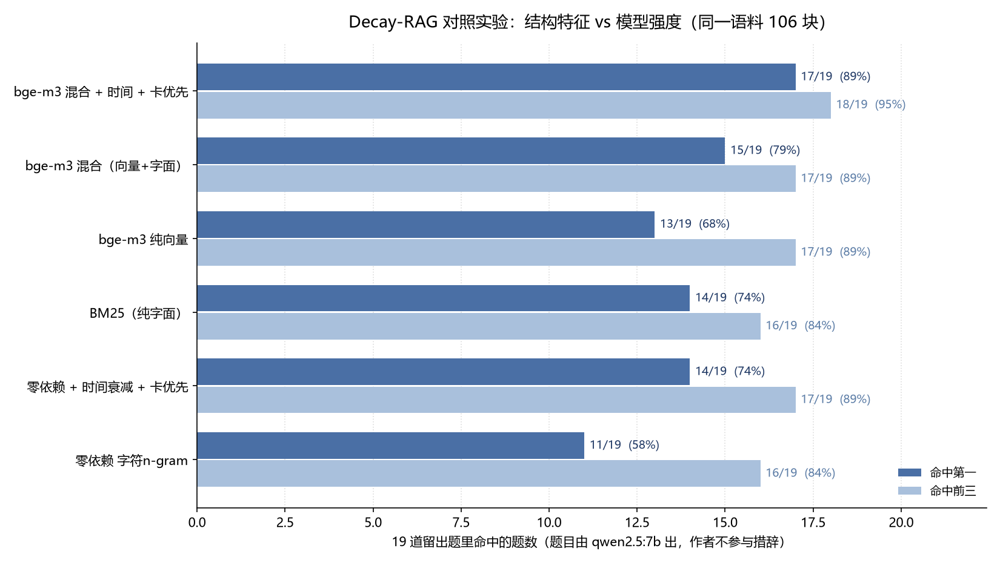
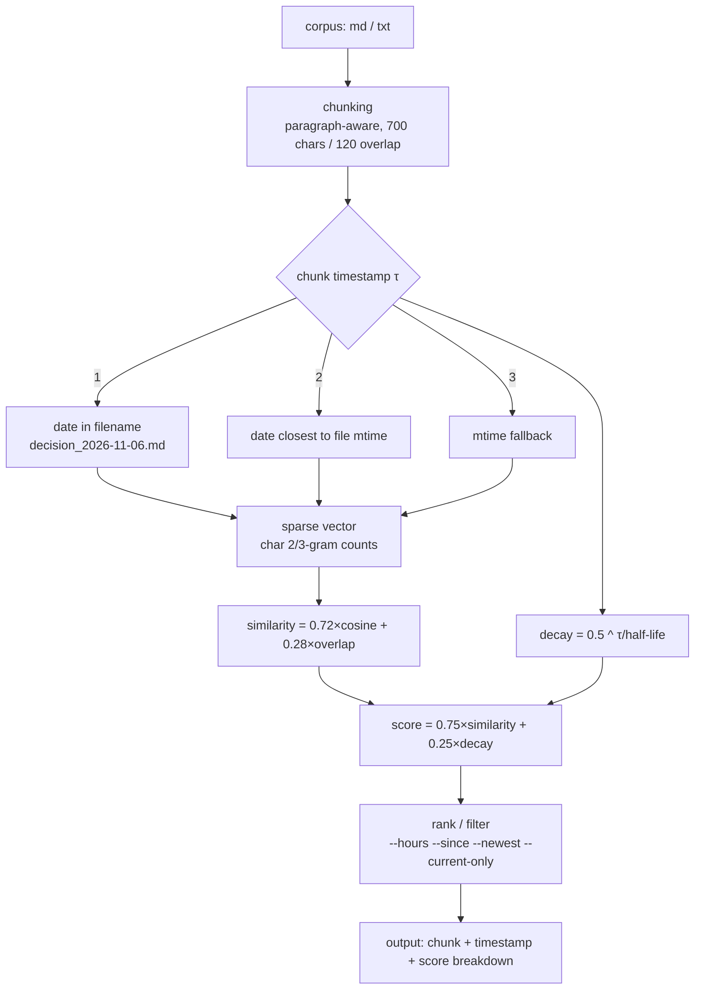

# A 235-line RAG with zero dependencies — and the numbers, honestly

**一个 235 行、零依赖的 RAG —— 数字照实说**

> ## ⚠️ 开发者工具，不是开箱即用的知识库
>
> 这是一个**检索算法的参考实现**（235 行、零依赖），不是一个“装上就能用”的 AI 知识库：
> 没有 UI、没有文档解析、没有数据库、没有对话编排。它解决的是“时间该怎么进排序”这一件事。
>
> 想要产品级：看 LlamaIndex / LangChain / RAGFlow / Dify。


> **14/19** with zero dependencies. **17/19** with a 1.2 GB embedding model.
>
> That's the gap: three questions out of nineteen. What you pay for those three is a `pip install`,
> an embedding service and 1.2 GB on disk. This README is about when that trade is worth it —
> and the one place where a 235-line script genuinely beats the big stack: **time**.
>
> `score = 0.75 × similarity + 0.25 × decay`, timestamps extracted **per chunk**, no vector database,
> no `pip install`, no GPU. Just Python 3.


---

## What it costs (read this before the pitch)

| | This repo | `bge-m3` + hybrid |
|---|---|---|
| Holdout accuracy (first hit) | 14/19 (74%) | **17/19 (89%)** |
| Install | none | model + runtime |
| Disk | 10 KB of code | ~1.2 GB model |
| Hardware | any Python 3 | CPU is fine, GPU helps |
| Language coverage | character n-grams: works on Chinese *because* it's characters, weak on synonyms | genuinely multilingual |

The three questions it loses are **synonym** questions: the user says "pause" and the card says
"protection hold". Character n-grams can't bridge that; an embedding model can. If your corpus is
full of synonyms and paraphrases, take the big model — this repo is not a replacement for it.

What this repo *does* claim, and tests: **file-mtime decay is broken on append-only corpora**
(diaries, running logs, weekly reports). One big file → one `mtime` → every chunk is "today" → decay
does nothing. Per-chunk timestamps fix that, and they're orthogonal to which similarity function
you use — you can port `parse_chunk_ts()` onto bge-m3, or into any framework, in an afternoon.

## The one idea that matters

Everyone "adds time" by using the file's modification time. That breaks on the most common personal
corpus there is — a diary, a weekly report, a running log: **one big file appended to forever**, so every
chunk shares the same `mtime`, and decay does nothing.

So the timestamp must be **per chunk**, decided in this order:

1. A date in the **filename** — `decision_2026-11-06.md` → `2026-11-06` (most reliable; name your files).
2. The date **closest to the file's mtime** among all dates in the chunk — *not* the first date.
3. `Oct 31` / `10-31` style shorthand (year inferred).
4. Fall back to `mtime`.

Rule 2 is the subtle one. A report often starts with "audited period 2019-01-02 to 2025-12-31". Take the
first date and the whole chunk is stamped 2019 → decay ≈ 0.00 → it can never rank. The writing time is
always *near* mtime; historical dates sit *far* from it. Pick the nearest, not the first.

## What it buys you

| Situation | Similarity only | With decay |
|---|---|---|
| Plan A approved 2 months ago, replaced by Plan B last week — "which one now?" | Plan A (written in more detail) | Plan B (newer) |
| 365 days of diary in one file | every chunk is "today" | each chunk has its own date |
| Doc text says "2019 audit period" | chunk stamped 2019, decay 0 | stamped with its writing date |

## Quick start

```bash
python decay_rag.py build data/sample --index idx.json          # build index
python decay_rag.py query "how much RAM does ZFS need" --index idx.json
python decay_rag.py query "which plan do we use now" --index idx.json --no-decay   # A/B toggle
python decay_rag.py query "..." --index idx.json --half-life 3                     # trust freshness more
python demo.py                                                                     # see it happen
python -m unittest discover -s tests -v                                            # 8 tests
```

Zero dependencies: no numpy, no vector store, no embedding server. Similarity is a sparse
character 2/3-gram cosine, computed in pure Python.

How good is it? On a 19-question holdout set (questions generated by a separate model, not by me),
the zero-dependency build answers **14/19** questions with the right document first (74%), and
**17/19** in the top three. Swapping in a 1024-dim embedding model (`bge-m3`) plus the same
time/authority priors reaches **17/19** (89%). Full numbers and method: [`docs/BENCH.md`](docs/BENCH.md).

## The formula

```
similarity = 0.72 × cosine(q, d) + 0.28 × overlap(q, d)
decay      = 0.5 ** (chunk_age_days / half_life)
score      = 0.75 × similarity + 0.25 × decay
```

| Constant | Default | Meaning |
|---|---|---|
| `W_COS / W_LEX` | 0.72 / 0.28 | semantic vs. lexical mix |
| `W_SIM / W_TIME` | 0.75 / 0.25 | content vs. freshness |
| `half_life` | 30 days | personal notes ≈ 30, live intel ≈ 1–3, textbooks ≈ 365 |

**Don't over-weight time.** Set `--half-life 1` and an irrelevant document written today outranks everything
(`demo.py` keeps that failure case on purpose). Time is the side dish.

## Results: what actually moves the needle



19 questions written by `qwen2.5:7b-instruct` from each card's symptom paragraph (I never wrote the
wording), 106 chunks of Chinese notes, scored as "is the right document ranked first".

| Retriever | Top-1 | Top-3 |
|---|---|---|
| Zero-dep char n-gram (default) | 11/19 (58%) | 16/19 (84%) |
| Zero-dep + time decay + card prior | **14/19 (74%)** | 17/19 (89%) |
| BM25 (lexical only) | 14/19 (74%) | 16/19 (84%) |
| bge-m3 dense only | 13/19 (68%) | 17/19 (89%) |
| bge-m3 hybrid (dense + lexical) | 15/19 (79%) | 17/19 (89%) |
| bge-m3 hybrid + time + card prior | **17/19 (89%)** | 18/19 (95%) |

Two things worth knowing:

1. **Structure beats model size here.** Adding time decay and a small card-authority prior lifts the
   zero-dependency build from 11 to 14 — roughly half the gain of going from char n-grams to a
   1024-dim embedding model, at zero inference cost.
2. **This is not a benchmark against LlamaIndex / LangChain.** Same corpus, same questions, our own
   components only. Those frameworks solve different problems (parsing, orchestration, stores, agents);
   comparing headline numbers would be dishonest. See [`docs/BENCH.md`](docs/BENCH.md) §4.

Reproduce: `docs/BENCH.md` §5, questions in [`docs/bench_cases.md`](docs/bench_cases.md).

## Sample corpus (`data/sample/`, entirely fictional)

A fictional "home NAS migration" project, 6 documents, each demonstrating one mechanism:

| File | What it demonstrates |
|---|---|
| `决策记录_2026-09-12.md` (decision, Sep) | old conclusion: TrueNAS + RAIDZ1 + ZFS snapshots |
| `决策记录_2026-11-06.md` (decision, Nov) | new conclusion: **supersedes** the above — single disk + cloud backup |
| `审计档案_2026-11-09.md` (audit) | body contains `2019-01-02` → the "don't take the first date" trap |
| `周记_2026-10-31.md` (weekly) | `10-31` shorthand date |
| `踩坑日志_2026-10-03.md` (log) | ordinary dated log |
| `运维手册.md` (runbook) | no date at all → falls back to `mtime` |

`python demo.py` prints:

```
--no-decay   → [1] decision_2026-09-12.md  0.258   ← old plan wins (it is more detailed)
default 30d  → [1] decision_2026-11-06.md  0.365   ← new plan floats up
half-life 1  → [1] runbook.md              0.263   ← over-weighted: fresh but irrelevant
```

> The sample project, numbers and conclusions are fictional. This repository contains only that
> fictional corpus — no real data of the author's is included.

## Pipeline



Also available as [`docs/flowchart.svg`](docs/flowchart.svg).

## CLI

| Flag | Default | Meaning |
|---|---|---|
| `--half-life` | 30 (days) | freshness horizon |
| `--no-decay` | off | turn time off, for A/B comparison |
| `--hours` / `--since` | off | hard window: drop old candidates entirely |
| `--newest` | off | pure recency, ignore relevance |
| `--current-only` | off | keep one chunk per file (anti-fragmentation) |
| `-k` | 5 | how many results |

## Why not the papers

| Approach | What it needs | Why not here |
|---|---|---|
| **TD-RAG** dynamic window | keep only the last N hours | fine for alerting; personal knowledge bases need old material 99% of the time |
| **Chronofy** exponential decay | a decay function | **adopted** — that's `0.5^(age/half_life)` |
| **T-GRAG** temporal graph | graph, version chains, conflict detection | maintenance cost exceeds benefit below ~10k chunks; `--current-only` covers most "give me the latest verdict" cases |

The trade-off: **keep one spine — chunk-level timestamps + exponential decay** — and make everything else a flag.
This is not a paper; it is something you can run on your own laptop and debug when it breaks.

## Files

```
decay_rag.py          core: chunking / timestamps / scoring / CLI (stdlib only)
demo.py               one-shot demo, including the over-weighted failure case
tests/test_decay.py   8 unit tests
data/sample/          fictional corpus (6 docs)
docs/SOP.md           标准作业流程 (Chinese): 7 steps with acceptance criteria
docs/algorithm.md     formulas, trade-offs, two post-mortems (Chinese)
docs/flowchart.svg    pipeline diagram
```

## Limitations

1. **No synonym handling.** Asking "who criticizes the critic" won't find "red team".
   Needs query expansion or a real embedding model (one function to swap).
2. **Not for numeric lookups.** "What's the budget?" belongs in a structured query, not vector search.
3. Timestamps are heuristic; a corpus with no dates at all degrades to `mtime` — i.e. back to square one.
4. Sparse character vectors penalize long documents; `--current-only` only mitigates.
5. `W_SIM=0.75 / W_TIME=0.25` is a prior tuned on a dozen questions, **not cross-validated**.

## 中文速览

- **一句话**：文件丢进去，脚本给**每一块**打时间戳（能识破正文里的 `2019-01-02` 这类历史日期），
  再按 `0.75 × 相似度 + 0.25 × 衰减` 排序，纯标准库、零依赖。
- **命门**：不能拿文件 mtime 当时间——日记、周报这类「一个大文件写到底」的语料会让所有块共享同一个 mtime，
  衰减等于没开；必须下沉到块级，且取「离 mtime 最近的日期」而不是「第一个日期」。
- **调参**：半衰期默认 30 天；给到 1 天时无关但最新的文档会冲上第一，`demo.py` 里留了这个反面例子。
- **SOP / 算法细节**：见 [`docs/SOP.md`](docs/SOP.md) 与 [`docs/algorithm.md`](docs/algorithm.md)。
- **实测成绩**（19 道留出题，题目由另一个模型出）：零依赖版 **14/19 首中、17/19 前三**；
  接上 bge-m3 嵌入 + 同样的时间/卡片先验 **17/19 首中、18/19 前三**。方法和逐题结果见
  [`docs/BENCH.md`](docs/BENCH.md)。**这不是和 LlamaIndex/LangChain 的横评**，只是同一语料下的组件对照。

## License

Business Source License 1.1 — source is visible and free for personal,
academic and internal non-commercial use; commercial use needs a license.
Change Date: 2030-11-17, after which it becomes Apache-2.0. See [LICENSE](LICENSE).
