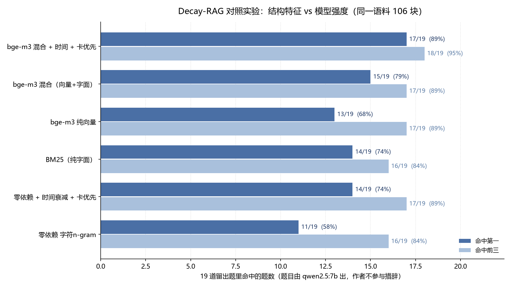

# 对照实验：同样是 19 道题，什么在起作用



一句话：**在这套语料上，结构特征（时间 + 卡片权威）比换成更大的嵌入模型更值钱。**

## 一、实验怎么做

- **语料**：106 块（19 张方法卡 + 3 篇方法论长文），全部中文。
- **题目**：19 道，由本地 `qwen2.5:7b-instruct` 读每张卡的「症状」段自动出题，要求口语、≤25 字。
  **作者没有参与措辞**——否则题会跟着答案长。
- **判定**：目标是「这张卡排第一」。排第 2 或第 3 记「前三命中」，不算首中。
- **同一批语料、同一批题目、同一台机器**，只换检索方式。

## 二、结果

| 检索方式 | 首中 | 前三 |
|---|---|---|
| 零依赖 字符 n-gram（仓库默认） | 11/19 (58%) | 16/19 (84%) |
| 零依赖 + 时间衰减 + 卡片优先 | **14/19 (74%)** | 17/19 (89%) |
| BM25（纯字面） | 14/19 (74%) | 16/19 (84%) |
| bge-m3 纯向量 | 13/19 (68%) | 17/19 (89%) |
| bge-m3 混合（向量 + 字面） | 15/19 (79%) | 17/19 (89%) |
| bge-m3 混合 + 时间 + 卡片优先 | **17/19 (89%)** | 18/19 (95%) |

## 三、读出来的四件事

1. **纯向量不如混合**（13 → 15）。中文短查询里，字面重合仍是强信号。
2. **加上时间衰减，两个档位各涨 2–3 题**（11→14、15→17）。原因很实在：同一个坑有新有旧，
   旧文档用词更"标准"，纯相似度会把它排前面。
3. **卡片优先只值 1–2 题，但它是零成本的**：一个常数 0.03，不需要模型、不需要重排。
4. **模型能补的差距有限**：bge-m3 比零依赖 n-gram 多 3 题（14→17），
   但**把时间 + 卡片先验加到零依赖版上，也能拿到 14 题**——快一半的收益来自结构，不是算力。

## 四、这不是"和 LlamaIndex / LangChain 比"

必须说清楚，免得读者误会：

- 上表比的是**同一套语料、同一批题目下的检索组件**，不是框架的总体能力。
- 那些框架解决的是别的问题：文档解析（PDF/表格）、多路召回编排、向量库持久化、工具调用、多轮 agent。
  本仓库只做一件事：**给检索加一个可解释的时间维度，并且不引入依赖**。
- 我**没有**把它们跑在同一批题上，所以任何"我们比它高 X 分"的说法都是假的。
  要真比，得先让它们吃同一份语料、用同一批题、同一套判定——那是另一项工程。

## 五、复现

```bash
# 1) 用零依赖版本建索引、跑题
python decay_rag.py build data
python decay_rag.py query data "解压那个压缩包放到哪儿啊？"

# 2) 换嵌入模型（本实验用 ollama + bge-m3）时，把 embed 接口换成 HTTP 调用即可，
#    再接同一个打分公式：sim = 0.72*cos + 0.28*字面；score = 0.75*sim + 0.25*decay
```

题目集与逐题结果见 `docs/bench_cases.md`。

## 六、已知的坑

- **19 道题太少**，一题就是 5 个百分点；表中的差距只能看趋势，不能看小数点。
- 两道题本身**无信息**（「这个命令咋在新版本里不管用了」），任何系统都难答对。
- 时间衰减只在**同一主题有多个版本**时有用；语料全是新的，它就等于不加分。
